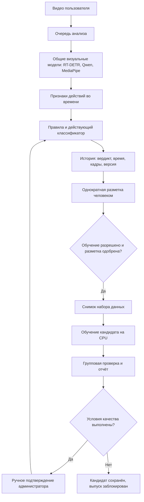

# Как устроен ChipTRick

## Что хранится на компьютере

Рабочая копия находится в `C:\Users\GGG\Desktop\datathon\ChipTrack-work`. Исходный `ChipTrack` сохранён отдельно. `.venv` содержит установленную среду Python; `models` — большие визуальные модели; `runtime` — базу пользователей, загруженные видео, журналы, отчёты и обученные классификаторы. Среда и визуальные модели общие для всех аккаунтов.

Проверенное оборудование: Intel Core i7-13650HX (14 ядер, 20 потоков), около 16 ГБ RAM, NVIDIA RTX 4060 Laptop с 8 ГБ видеопамяти. CUDA работает. Такая конфигурация подходит для выбранного локального анализа и малого CPU-классификатора; точность зависит прежде всего от различимости действий и данных, а не только от скорости компьютера.

Начинать большие визуальные модели с нуля на 42 роликах непрактично. Сохраняются готовые визуальные представления, а изменяются проверки, временные признаки, небольшой классификатор и процесс проверки его качества.

## От загрузки до ответа

1. Пользователь входит в аккаунт. Сервер хранит хеш пароля; браузер получает ограниченную по времени сессию.
2. Видео сохраняется в `runtime/media`, а в SQLite записываются владелец, время загрузки и хеш содержимого. По умолчанию обучение на этой загрузке выключено.
3. Задание попадает в очередь одного GPU-обработчика. Когда начинается анализ, за заданием закрепляется действующая версия. Позднейшее переключение версии не меняет уже начатую работу.
4. OpenCV извлекает кадры с частотой 2 кадра в секунду. RT-DETRv2 ищет людей и обычные предметы. Он сам по себе не распознаёт нарушения банковских правил.
5. Qwen3-VL определяет положение стола, сейфа, ноутбука и двери. Области ищутся заново для каждого видео, а не задаются координатами одной камеры.
6. Траектории людей и ответы визуальной модели образуют временную шкалу: присутствие у стола, работа у сейфа, входы/выходы и вероятное обслуживание клиента.
7. На коротких последовательностях кадров проверяются наблюдаемые действия: передача денег в обе стороны, аппарат, пачки и помещение денег в сейф. Контекст выбирает применимые проверки; жёсткого требования выполнить все действия в одном порядке нет.
8. Правила связывают визуальные признаки во времени. Например, X-1 относится к возврату ранее принятых денег клиенту; X-22 — к ключу, оставленному в замке после отхода от сейфа. Дополнительно проверяются документы, экран, дверь, оставленные ценности и другие поддерживаемые типы.
9. Если выпущен обученный классификатор, он получает те же числовые признаки временных окон и добавляет свои находки или гипотезы. При достаточной обучающей поддержке он также может отклонить ошибочное событие старых правил. Для этого нужны не менее трёх положительных и пяти отрицательных уникальных роликов по типу и низкий результат классификатора во всех окнах вокруг события. Названия файлов и номера X-1/X-22 в его вход не входят.
10. Результат сохраняет исходный ответ, типы, таймкоды, кадры, версию и полноту анализа. Непроведённая проверка не подтверждает отсутствие нарушения. Неопределённые случаи получают «Требует просмотра».
11. Создаётся MP4 для браузерного просмотра. Исходный загруженный файл сохраняется. Доступ к видео проверяется по владельцу; администратор имеет доступ к разметке и видео API.

Оценка уверенности — числовая сила визуальных признаков, а не доказанная вероятность правильного ответа. Значение 0,95 не означает, что система права в 95% случаев.

### Почему для передачи денег нужна дополнительная проверка

При проверке обнаружилась конкретная ошибка: Qwen3-VL могла назвать обычное перекладывание пачки передачей клиенту. Более крупная модель 4B в проведённом эксперименте эту путаницу не устранила, поэтому рабочей остаётся 2B.

Для предполагаемого возврата добавлен отдельный MediaPipe Pose Landmarker. Люди обрабатываются в отдельных областях кадра, положение запястий сравнивается на соседних кадрах. Требуется сближение рук после их раздельного положения. Это дополнительное визуальное условие, а не доказательство принадлежности денег: направление и предыдущий приём по-прежнему проверяются по последовательности кадров. Если руки не удаётся увидеть, случай требует просмотра. Модель позы общая для всех пользователей, её веса занимают около 9 МБ.

Порог расстояния нормируется размером найденного стола. Его работа на другой камере ещё не подтверждена; проверка на текущих видео не заменяет такую проверку.

## Какие признаки соответствуют типам нарушений

| Тип | Что проверяет код | Где возможна ошибка |
|---|---|---|
| T01, ценности без присмотра | Отход от рабочего места и банкноты, сумка или документы на столе | Человека за стеклом можно ошибочно принять за присутствующего; мелкая пачка может быть не видна |
| T02, незаблокированный ноутбук | Отход, рабочее содержимое экрана, отсутствие признаков блокировки/закрытой крышки | На маленьком экране трудно отличить рабочее окно от экрана блокировки |
| T03, открытый сейф | Сейф остаётся открытым после отхода или несколько проверок подряд без человека рядом | Отражение и тёмная дверца могут выглядеть как открытый сейф |
| T04, оставленный ключ | Ключ в области замка после отхода от сейфа | Ключ занимает мало пикселей; видимость зависит от ракурса |
| T05, деньги при следующем клиенте | Уход посетителя, новый вход и оставшиеся банкноты | Нужно правильно различать людей и принадлежность денег операции |
| T06, два клиента | Несколько людей и два подтверждения одновременного обслуживания | Простое присутствие второго человека ещё не доказывает обслуживание |
| T07, незакрытая дверь | Вход человека, движение у двери и последующие состояния двери | Стеклянная дверь и перекрытия затрудняют определение открытого состояния |
| T10, личные вещи | Предметы на столе с дополнительным исключением инкассаторской сумки | Назначение похожих сумок по изображению неоднозначно |
| T11, напитки | Действие питья на соседних кадрах, чашка; дополнительная проверка на банкноты в руках | В X-1 прежняя модель путала движение пачки с питьём |
| T12, документы | Устойчивое обслуживание и минимум восемь проверенных кадров без видимого удостоверения | В X-2 банкноты ошибочно принимаются за удостоверение; проверка могла быть вне ролика |
| T13, смешение | Последовательность перемещений пачек и подтверждение их объединения | Принадлежность пачек разным операциям не всегда видна; тип остаётся слабым |
| T14, возврат денег | Предыдущий приём, предполагаемый возврат тому же посетителю и сближение рук | Qwen может путать направления; проверка рук уменьшает ошибку, но не решает все перекрытия |
| T15, отсутствие пересчёта | Сопоставление признаков принятия/сейфа и аппарата | Надёжного автоматического подтверждения пока нет; отсутствие видимого действия не доказывает его пропуск |

Небольшой обучаемый классификатор получает 70 числовых признаков каждого окна: максимум, среднее и наличие наблюдений для 22 признаков, а также присутствие людей, занятость рабочего места, близость к сейфу и обслуживание. Окна длиной до 8 секунд сдвигаются на 4 секунды. Он может уточнять сочетания уже извлечённых признаков, но не восстановит невидимый ключ или документ, если визуальная обработка не дала полезного сигнала.

## Однократное исправление

Пользователь указывает окончательный вердикт и, если есть нарушение, один или несколько типов с началом и концом каждого интервала. Подтверждение сохраняется отдельной записью. Исходный ответ модели остаётся доступным. Ограничение «один раз» обеспечивается и API, и ограничениями SQLite, а не только скрытием кнопки.

Переключатель обучения независим от этого ограничения. Его можно менять позже. Включение переключателя само по себе не обучает модель на её собственном ответе: нужен проверенный человеком итог.

## Как исправление превращается в новую версию

1. Администратор открывает «Проверка разметки», смотрит ролик, интервалы и комментарий. Одобряет или отклоняет разметку.
2. В набор попадают только разрешённые для обучения загрузки с одобренной разметкой и совместимыми полными признаками. Видео жюри тоже разрешены по требованию владельца проекта; для них действует тот же переключатель.
3. Одинаковые файлы объединяются по SHA256. Противоречащая разметка одного файла исключается до разрешения конфликта.
4. После пяти новых уникальных проверенных примеров фоновый планировщик запускает кандидата. Администратор также может нажать «Обучить кандидата» или выполнить `python -m app.cli train`.
5. Создаётся снимок набора данных. Маленькая модель обучается на CPU: стандартизация признаков, отдельные логистические выходы для типов, 180 эпох градиентного спуска с балансировкой классов и регуляризацией. Реальные loss и эпохи записываются в журнал.
6. Большие RT-DETRv2 и Qwen3-VL при этом не переобучаются. Действующая версия продолжает обслуживать пользователей на GPU.
7. Для оценки данные разделяются на группы по исходному видео. Отрезки одного ролика и его дубликаты не могут одновременно попасть в обучение и проверку одного fold. Считаются обнаружение нарушения, правильность типа и попадание в размеченный интервал с допуском 2 секунды; события сопоставляются один к одному.
8. Отчёт содержит результаты действующей версии и кандидата на одних признаках, ошибки по каждому ролику и допуск к выпуску. Типам с менее чем тремя положительными обучающими видео не разрешено автоматически добавлять уверенные находки.
9. Кандидат допускается к выпуску, только если есть улучшение правильных событий, ложных событий или числа ручных просмотров. При этом запрещено уменьшать число правильных событий, добавлять ложные события и тревоги на нормальных видео, увеличивать пропуски или число ручных просмотров. Отсутствие улучшения блокирует выпуск. Это минимальные условия разработки; они не подтверждают качество на неизвестной камере.
10. Администратор читает отчёт в «Модель и обучение» и вручную выпускает подходящую версию. Автоматического переключения действующей версии сейчас нет.
11. Переключается идентификатор в базе. Следующее задание использует новые небольшие веса. Предыдущие результаты не переписываются. Можно вернуть ранее выпущенный классификатор, совместимый с текущим кодом извлечения признаков.

Если разрешение на пример отозвали после обучения, новый кандидат, использовавший этот пример, не может быть выпущен. Следующее обучение исключит его. Уже выпущенная модель не умеет мгновенно «забывать» отдельное видео — для этого нужен новый набор и переобучение.

## Что означает «версия»

Версия включает идентификатор визуальных моделей, отпечаток кода извлечения признаков и правил, схему признаков, веса обученного классификатора (если есть), снимок данных и отчёт. Это не отдельная копия всей среды для каждого человека.

`rules-2.0-…` обозначает базовые правила и визуальную обработку. `candidate-…` — обученный вариант малого классификатора. Статус «кандидат» означает, что он ещё не обслуживает обычные загрузки. После ручного выпуска эта же версия становится действующей.

Обновление кода визуальной обработки несовместимо со старыми кешированными признаками. Такое обновление создаёт другую базовую версию. Откат между разными кодовыми базами требует соответствующей копии приложения; кнопка отката классификатора этого не делает.

## Где смотреть работу

- `inference.jsonl`: загрузка визуальных моделей, версия задания, контекст и признаки по отрезкам, этапы анализа, ошибки и итог.
- `training.jsonl`: состав набора, настоящие эпохи/loss, групповая оценка и завершение кандидата.
- `versions.jsonl`: исправления, разрешения на обучение, проверка разметки, создание и выпуск версии, откат.
- `all.jsonl`: общий поток тех же событий.

Кнопки запуска журналов и команды приведены в `JURY_DEMO.md`. Отчёты и журналы сохраняются после завершения процесса; быстрая тренировка малого классификатора не сопровождается искусственными задержками или выдуманными эпохами.

## Границы текущей проверки

42 строки разметки относятся к 40 уникальным видео. Все они известны разработке. Групповая проверка защищает от смешивания отрезков одного файла, но не превращает этот набор в независимый тест: правила и вопросы визуальной модели тоже подбирались на этих сценах. Если видео жюри включили в обучение, последующая проверка на том же видео также не является независимой.

Один ноутбук выполняет GPU-анализы последовательно. Ожидание очереди показывается отдельно; при большом числе одновременных загрузок полное время от загрузки может превышать пять минут. Локальный сервер доступен на `127.0.0.1:8000`; публичное размещение и масштабирование требуют отдельной настройки.

Система предназначена для разбора видео и проверки оператором. Новые ракурсы, мелкие предметы, перекрытие рук, неразличимые документы и неполные действия могут требовать ручного просмотра. Актуальные измерения и конкретные ошибки находятся в отчётах `runtime/reports`, а не в исторических цифрах прежней версии.
